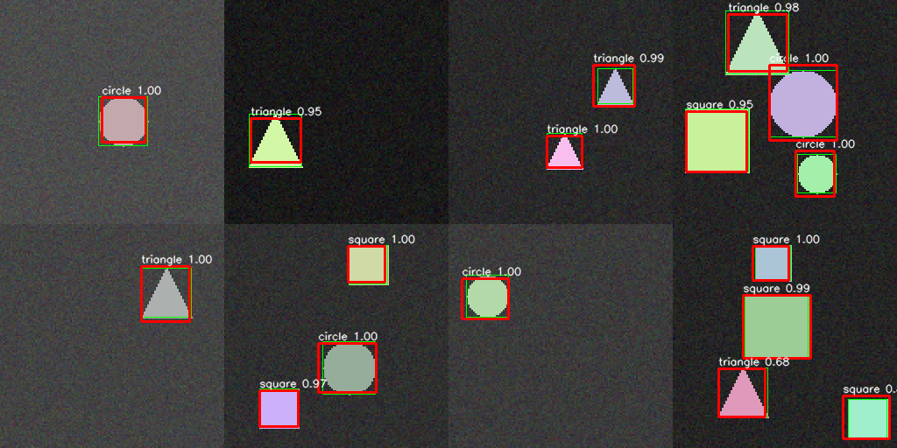

# Shape Detector: object detection from scratch in PyTorch + OpenCV

A small YOLO-style detector that finds and classifies circles, squares and triangles
in images. Built end to end: data generation, model, loss, training, evaluation and inference.

## Why synthetic data?
Training data is generated on the fly with OpenCV (random shapes, sizes, colours,
positions, 1-4 objects per image, Gaussian noise), so the project runs anywhere with
no downloads and the ground-truth boxes are exact. It is a learning/prototyping
setup, **not** a claim about real-world performance.

## Pipeline
| File | What it does |
|---|---|
| `data.py` | OpenCV image generator, grid-target encoding, PyTorch `Dataset` |
| `model.py` | 80k-parameter CNN, detection loss, box decoding, non-max suppression |
| `train.py` | Training loop (AdamW + OneCycle LR), test evaluation, plots |
| `evaluate.py` | Per-class AP@IoU 0.5, mAP, precision, recall (implemented from scratch) |
| `evaluate_saved.py` | Re-scores the checkpoint with vs. without NMS |
| `infer.py` | Run the trained model on any image |

## How it works
1. The image (128x128) goes through 4 conv blocks and is reduced to an **8x8 grid**.
2. Each grid cell predicts: objectness, box centre offset (x, y), box size (w, h) and 3 class scores.
3. The loss combines objectness (down-weighting empty cells), box regression (sqrt on w/h so
   small boxes matter), and classification, all computed only where an object exists.
4. At inference, cells above a confidence threshold become boxes; **NMS** removes duplicates.

## Results (500 held-out test images, 1,221 objects, 25 epochs on CPU, ~20 min)
| | mAP@0.5 | Precision | Recall |
|---|---|---|---|
| Without NMS | 0.982 | 0.949 | 0.984 |
| With NMS | 0.984 | 0.998 | 0.984 |

Per-class AP@0.5 (with NMS): circle 0.988, square 0.972, triangle 0.993.

## Known limitations
- One object per grid cell, so overlapping/adjacent objects can be missed (generator avoids this).
- Synthetic, clean shapes; no real-world clutter, lighting or occlusion.
- Train loss (0.09) is well below validation loss (0.36): the model overfits somewhat.

## Run it
```
pip install torch opencv-python numpy matplotlib
python train.py 25
python evaluate_saved.py
python infer.py some_image.png result.png
```
